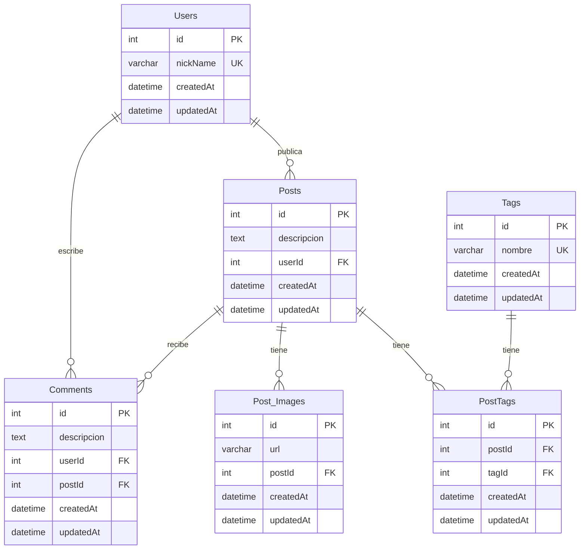

# Red Anti-Social

Backend de una red social desarrollado como proyecto académico grupal en la Universidad Nacional de Hurlingham.

El sistema permite gestionar usuarios, publicaciones, imágenes, comentarios y etiquetas mediante una API REST. Está desarrollado con Node.js y Express, utilizando Sequelize para la persistencia de datos y Joi para la validación de solicitudes.

## Tecnologías utilizadas

- **Node.js:** entorno de ejecución.
- **Express.js:** framework para el desarrollo de la API REST.
- **Sequelize:** ORM para la interacción con bases de datos relacionales.
- **SQLite / MariaDB:** motores de bases de datos soportados.
- **Joi:** validación de datos de entrada.
- **Swagger / OpenAPI:** documentación de la API.
- **Postman:** pruebas de endpoints y solicitudes HTTP.

## Funcionalidades principales

- Gestión de usuarios (CRUD).
- Creación, consulta, modificación y eliminación de publicaciones.
- Gestión de imágenes asociadas a publicaciones.
- Sistema de comentarios entre usuarios.
- Gestión de etiquetas y asociación con publicaciones.
- Validación de solicitudes mediante esquemas de Joi.
- Control de errores y respuestas HTTP.
- Visibilidad configurable de comentarios según su antigüedad.
- Documentación de endpoints mediante Swagger.

## Mi contribución

Participé en el desarrollo del backend, principalmente en la implementación de las operaciones CRUD de usuarios, publicaciones e imágenes asociadas a los posts.

Mis responsabilidades incluyeron:

- Desarrollo de rutas y endpoints con Express.
- Implementación de controladores para gestionar las operaciones CRUD.
- Desarrollo de middlewares para el procesamiento y validación de solicitudes.
- Definición e implementación de esquemas de validación utilizando Joi.
- Integración de las operaciones con los modelos de Sequelize.
- Pruebas de funcionamiento de los endpoints utilizando Postman.

## Arquitectura y modelo de datos

El sistema utiliza una base de datos relacional con las siguientes entidades principales:

- **User:** representa a los usuarios registrados.
- **Post:** representa las publicaciones realizadas por los usuarios.
- **Post_Images:** almacena las URL de las imágenes asociadas a publicaciones.
- **Comment:** representa los comentarios realizados sobre publicaciones.
- **Tag:** representa las etiquetas utilizadas para clasificar publicaciones.
- **PostTags:** tabla intermedia que establece la relación muchos a muchos entre publicaciones y etiquetas.

### Diagrama entidad-relación



- Un usuario tiene muchos posts y muchos comentarios (1:N). Un post tiene muchos comentarios y muchas imágenes (1:N).
- Post y Tag son muchos a muchos (N:M) y se unen por la tabla PostTags, que guarda las dos claves foráneas.
- Todos los campos son obligatorios (`NOT NULL`), salvo las fechas que completa Sequelize. `nickName` y `nombre` no se pueden repetir, y el par `postId` + `tagId` tampoco.
- Todas las claves foráneas tienen `ON DELETE CASCADE`: al borrar un usuario o un post se borra lo que depende de él.
- `visible` en Comments no es una columna: se calcula con un atributo virtual de Sequelize comparando `createdAt` con `MONTHS_TO_HIDE_COMMENTS`.

## Documentación de la API

La API cuenta con documentación basada en Swagger / OpenAPI, accesible desde el servidor.

Una vez iniciado el proyecto:

[http://localhost:3000/api-docs](http://localhost:3000/api-docs)

## Instalación y configuración

### Requisitos previos

- Node.js 18 o superior.
- npm.

### 1. Clonar el repositorio

```bash
git clone URL_DEL_REPOSITORIO
cd ejercicio-56-grupo-33
```

### 2. Instalar dependencias

```bash
npm install
```

### 3. Configurar variables de entorno

Copiar el archivo `.env.example` y crear un archivo `.env`.

En Windows:

```bash
copy .env.example .env
```

En Linux / macOS:

```bash
cp .env.example .env
```

Por defecto, el proyecto utiliza SQLite, por lo que no requiere una configuración adicional de base de datos.

### 4. Ejecutar migraciones

```bash
npx sequelize-cli db:migrate
```

### 5. Iniciar el servidor

```bash
npm start
```

Para desarrollo:

```bash
npm run dev
```

El servidor estará disponible en:

`http://localhost:3000`

## Variables de entorno

| Variable                | Descripción                               | Valor por defecto    |
| ----------------------- | ----------------------------------------- | -------------------- |
| PORT                    | Puerto del servidor                       | 3000                 |
| DB_DIALECT              | Motor de base de datos                    | sqlite               |
| DB_STORAGE              | Ubicación de la base SQLite               | ./src/data/Db_app.db |
| DB_HOST                 | Host de la base de datos                  | 127.0.0.1            |
| DB_PORT                 | Puerto de la base de datos                | 3306                 |
| DB_NAME                 | Nombre de la base de datos                | red_antisocial       |
| DB_USER                 | Usuario de la base de datos               | root                 |
| DB_PASSWORD             | Contraseña de la base de datos            | Vacía                |
| MONTHS_TO_HIDE_COMMENTS | Antigüedad máxima de comentarios visibles | 6                    |

## Endpoints disponibles

| Recurso         | Rutas                                                                                         |
| --------------- | --------------------------------------------------------------------------------------------- |
| Usuarios        | GET, POST `/usuarios` · GET, PUT, PATCH, DELETE `/usuarios/:id`                               |
| Posts           | GET, POST `/posts` · GET, PUT, PATCH, DELETE `/posts/:id`                                     |
| Imágenes        | GET, POST `/posts/image` · GET, PUT, DELETE `/posts/image/:id`                                |
| Comentarios     | GET, POST `/comentarios` · GET, PUT, DELETE `/comentarios/:id` · GET `/posts/:id/comentarios` |
| Tags            | GET, POST `/tags` · GET, PUT, DELETE `/tags/:id` · GET `/tags/:id/posts`                      |
| Tags de un post | POST, DELETE `/posts/:id/tags/:tagId`                                                         |

El detalle de cada uno, con los cuerpos y los códigos de error, está en `/api-docs`.

## Pruebas

Se utilizó **Postman** para realizar pruebas de los endpoints de la API, verificando las operaciones disponibles y las respuestas HTTP del servidor.

## Proyecto académico

Desarrollado en equipo como parte de un trabajo práctico de la carrera Licenciatura en Informática de la Universidad Nacional de Hurlingham.
