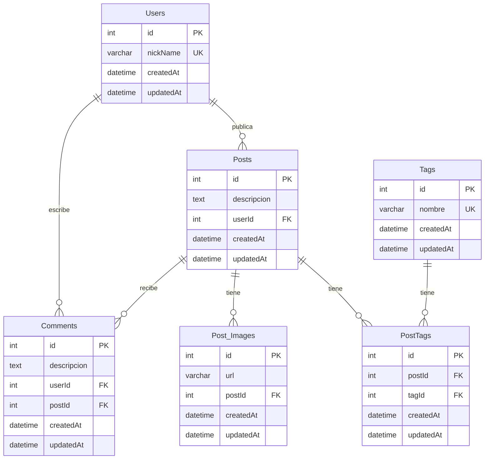

# Red Anti-Social

Se solicita el modelado y desarrollo del backend de una red social llamada **“UnaHur Anti-Social Net”**, inspirada en plataformas populares donde los usuarios publican contenido y reciben comentarios sobre él.


# Contexto del Proyecto

En una primera reunión con los sponsors se definió el alcance de un **MVP (Producto Mínimo Viable)**. Lo que sigue es lo que ellos pidieron: **cómo resolverlo es decisión del equipo**.

- Un usuario registrado puede hacer publicaciones. Toda publicación tiene **obligatoriamente una descripción** y, opcionalmente, **una o más imágenes**. Las imágenes se pueden agregar o quitar después de publicado el post.
- Las publicaciones pueden recibir **comentarios** de otros usuarios.
- Las publicaciones pueden tener **etiquetas (tags)**, y una misma etiqueta puede aparecer en muchas publicaciones.
- Los **comentarios con más de X meses de antigüedad no deben mostrarse** al consultar un post. X tiene que ser configurable sin tocar el código. Si un comentario está visible o no **no se guarda en la base**: se calcula con un **atributo virtual** de Sequelize.

# Entidades

Los sponsors usan estos nombres para hablar del dominio. Respetenlos en el modelo:

- **User**: usuario registrado. Se identifica por su `nickName`, que no se puede repetir.
- **Post**: publicación que hace un usuario en una fecha determinada.
- **Post_Images**: imágenes asociadas a un post. Para el MVP alcanza con guardar la **URL** de la imagen.
- **Comment**: comentario de un usuario sobre un post, hecho en una fecha determinada.
- **Tag**: etiqueta que se le puede asignar a un post.

Los atributos, las relaciones, las claves y las restricciones las definen ustedes a partir de los requerimientos. Tienen que poder justificar cada decisión.

# Stack obligatorio

- **Node.js** con **Express**.
- Base de datos **relacional**, accedida **exclusivamente con Sequelize** (modelos y asociaciones). No se aceptan consultas SQL escritas a mano ni persistencia en memoria o archivos.
- Validación de los datos de entrada con **Joi**, aplicada a través de **middlewares** de Express.

# Qué se espera

- Un **DER** que refleje el modelo de datos.
- Una **API REST** que permita operar sobre todas las entidades y sobre las relaciones entre ellas.
- **Validaciones** que garanticen la integridad de los datos: que no entren datos inválidos (schemas de Joi en middlewares) y que las relaciones sean consistentes (por ejemplo, no comentar un post que no existe). Ante un error, la API tiene que responder con un código HTTP adecuado y un mensaje claro.
- Poder **cambiar de motor de base de datos** solo con configuración e instalación de dependencias, sin modificar el código.
- Que el **puerto** y demás parámetros (incluido el de los X meses) se configuren mediante **variables de entorno**.
- Un README con las instrucciones para levantar el proyecto desde cero.

# Documentación y pruebas: a investigar

Estos dos puntos **no se van a ver en clase**. Parte del trabajo es investigar por su cuenta qué son, para qué sirven y cómo se integran al proyecto.

- **Swagger / OpenAPI**: la API tiene que estar documentada con una especificación en formato **YAML** que cubra **todos** los endpoints, con sus parámetros, cuerpos de request, respuestas y códigos de error. La documentación tiene que poder consultarse desde el propio servidor.
- **Colecciones de prueba**: entregar una colección (Postman, Insomnia, Bruno, Thunder Client o la herramienta que elijan) que permita probar todos los endpoints, incluyendo casos de error.

# Bonus

Los bonus **tampoco se ven en clase**. Requieren investigar por su cuenta más allá de lo pedido para el MVP.

1. Permitir subir las imágenes de un post al servidor y guardarlas en una carpeta del servidor web, en lugar de recibir solo la URL.
2. ¿Cómo modelarían que un usuario pueda **seguir** a otros y a su vez ser seguido por muchos (followers)? Implementarlo.

# Cómo levantarlo

Necesitás Node 18 o más nuevo y npm.

1. Instalá las dependencias:

```bash
npm install
```

2. Copiá el archivo de variables de entorno (en Windows: `copy .env.example .env`):

```bash
cp .env.example .env
```

Con los valores por defecto usa SQLite y no hay que configurar nada más.

3. Creá las tablas con las migraciones:

```bash
npx sequelize-cli db:migrate
```

4. Levantá el servidor:

```bash
npm start
```

Para desarrollo, `npm run dev` lo reinicia solo cuando guardás un cambio. El servidor queda en http://localhost:3000 y la documentación de la API en http://localhost:3000/api-docs.

# Variables de entorno

| Variable | Para qué sirve | Por defecto |
|---|---|---|
| PORT | Puerto del servidor | 3000 |
| DB_DIALECT | Motor de base de datos (`sqlite` o `mariadb`) | sqlite |
| DB_STORAGE | Archivo de la base, solo para SQLite | ./src/data/Db_app.db |
| DB_HOST | Host de la base | 127.0.0.1 |
| DB_PORT | Puerto de la base | 3306 |
| DB_NAME | Nombre de la base | red_antisocial |
| DB_USER | Usuario de la base | root |
| DB_PASSWORD | Contraseña de la base | vacía |
| MONTHS_TO_HIDE_COMMENTS | Meses desde los que un comentario deja de mostrarse | 6 |

# Cambiar de motor

Para pasar a MariaDB no se toca código. Creá una base vacía, completá `DB_DIALECT=mariadb`, `DB_HOST`, `DB_PORT`, `DB_NAME`, `DB_USER` y `DB_PASSWORD` en el `.env`, y corré de nuevo las migraciones.

# Modelo de datos



- Un usuario tiene muchos posts y muchos comentarios (1:N). Un post tiene muchos comentarios y muchas imágenes (1:N).
- Post y Tag son muchos a muchos (N:M) y se unen por la tabla PostTags, que guarda las dos claves foráneas.
- Todos los campos son obligatorios (`NOT NULL`), salvo las fechas que completa Sequelize. `nickName` y `nombre` no se pueden repetir, y el par `postId` + `tagId` tampoco.
- Todas las claves foráneas tienen `ON DELETE CASCADE`: al borrar un usuario o un post se borra lo que depende de él.
- `visible` en Comments no es una columna: se calcula con un atributo virtual de Sequelize comparando `createdAt` con `MONTHS_TO_HIDE_COMMENTS`.

# Endpoints

| Recurso | Rutas |
|---|---|
| Usuarios | GET, POST `/usuarios` · GET, PUT, PATCH, DELETE `/usuarios/:id` |
| Posts | GET, POST `/posts` · GET, PUT, PATCH, DELETE `/posts/:id` |
| Imágenes | GET, POST `/posts/image` · GET, PUT, DELETE `/posts/image/:id` |
| Comentarios | GET, POST `/comentarios` · GET, PUT, DELETE `/comentarios/:id` · GET `/posts/:id/comentarios` |
| Tags | GET, POST `/tags` · GET, PUT, DELETE `/tags/:id` · GET `/tags/:id/posts` |
| Tags de un post | POST, DELETE `/posts/:id/tags/:tagId` |

El detalle de cada uno, con los cuerpos y los códigos de error, está en `/api-docs`.
